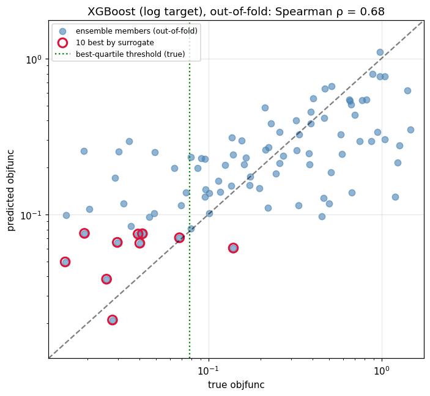
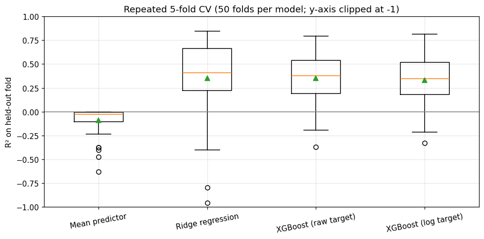
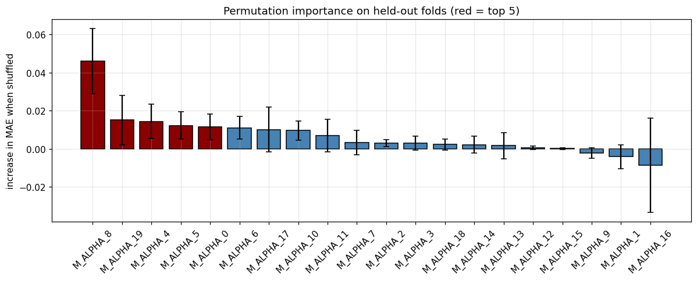

# Surrogate modelling of history-matching quality

Can a cheap machine-learning model tell which history-matching candidates are worth a full reservoir
simulation run? This project trains an XGBoost **surrogate** that predicts the history-matching objective
function (misfit between simulated and observed production data) directly from the history-matching
parameters, using 92 ensemble members of an ensemble-smoother (ES-MDA) experiment run in tNavigator.

The full analysis is in [`notebooks/surrogate_history_matching.ipynb`](notebooks/surrogate_history_matching.ipynb).

## Key results

Repeated 5-fold cross-validation (5 folds × 10 repeats). Spearman ρ and hit rate are computed on
out-of-fold predictions, i.e. every member is predicted by a model that never saw it.

| Model | R² (mean ± sd) | MAE | Spearman ρ | Top-10 hit rate* |
|---|---|---|---|---|
| Mean predictor (baseline) | −0.09 ± 0.14 | 0.295 | — | 0.25 (random choice) |
| Ridge regression | 0.35 ± 0.38 | 0.206 | 0.51 | 0.50 |
| XGBoost, raw target | 0.35 ± 0.26 | 0.203 | 0.70 | 0.74 |
| **XGBoost, log target** | **0.33 ± 0.25** | **0.184** | **0.70** | **0.76** |

\* Share of the 10 candidates ranked best by the surrogate that truly belong to the best 25 % of the ensemble.

* **The surrogate is useful for screening.** It orders candidates well (ρ ≈ 0.70), and about three out of
  four of its top-10 picks are truly among the best quartile — three times better than picking at random.
  A linear model reaches a similar R² but ranks much worse.
* **The log-transformed target** lowers the mean absolute error by about 9 % and stabilises the ranking, but
  does not increase R² under cross-validation. A single 75/25 split gave test R² 0.35 → 0.70; across 50 random
  splits the hold-out R² ranges from below 0 to about 0.8, so single-split numbers are not reliable on 92 samples.
* **One parameter dominates.** `M_ALPHA_8` has about three times the permutation importance of any other variable.
* **Speed.** A surrogate evaluation takes under 1 ms versus about 13 s for one simulation run of this model —
  roughly a 10⁴× speed-up per evaluation, after a one-time cost of 92 training simulations.



<p float="left">
  
  
</p>

## Data

| File | Content |
|---|---|
| `data/es_mda_results.csv` | 92 ES-MDA ensemble members: the 20 history-matching variables `M_ALPHA_0 … M_ALPHA_19` (model inputs), the objective function `objfunc` (target, lower is better) and field-level simulated values (`field_*`, simulation outputs, not used as inputs). |
| `data/simulation_runtimes.csv` | Wall-clock time of each simulation run of the history-matching project, used for the speed-up estimate. |

The table was exported from a history-matching project in tNavigator built on a synthetic 3D reservoir model
from the tNavigator training materials. The simulation runs were performed by the author. The reservoir model
files and raw simulator output are not included in this repository for licensing reasons.

## Method

1. Exploratory analysis of the parameters and of the strongly right-skewed objective function.
2. Four models: mean predictor, ridge regression, XGBoost on the raw target and XGBoost on
   `log(objfunc + 0.01)` (predictions transformed back, so all metrics are on the original scale).
3. Evaluation: the original single hold-out split, its sensitivity to the random split, and repeated 5-fold
   cross-validation.
4. Ranking quality for candidate screening (Spearman ρ, top-10 hit rate).
5. Permutation importance measured on held-out folds.
6. Speed-up of a surrogate evaluation compared with a full simulation run.

## Limitations

* Small data set (92 members) from a single synthetic model; results may not transfer to real fields or other
  parameterisations.
* The XGBoost models over-fit the training data (train R² ≈ 1). Hyper-parameters were not tuned on so few
  samples; regularisation with nested cross-validation is the next step.
* All members come from one ensemble-smoother run, so they cover only part of the parameter space.

## Repository structure

```
├── data/
│   ├── es_mda_results.csv
│   └── simulation_runtimes.csv
├── figures/                 # figures generated by the notebook
├── notebooks/
│   └── surrogate_history_matching.ipynb
├── requirements.txt
└── LICENSE
```

## How to run

Tested with Python 3.13; the pinned package versions also support Python 3.10–3.12.

```bash
python -m venv .venv
# Windows: .venv\Scripts\activate    macOS/Linux: source .venv/bin/activate
pip install -r requirements.txt
jupyter lab notebooks/surrogate_history_matching.ipynb
```

Running all cells takes about half a minute and regenerates the figures in `figures/`.

## Author

Maksim Shaikhullin — petroleum engineer (reservoir simulation).

## License

The code is released under the [MIT License](LICENSE).
